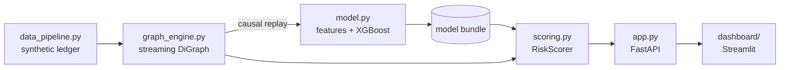

# Graph-Based AML & Fraud Detection Pipeline

A transaction-monitoring pipeline that combines **graph topology** (fan-in, fan-out,
circular flows) with **gradient-boosted trees** to score transfers in real time.
It covers the whole path: synthetic ledger with injected laundering typologies →
streaming graph engine → imbalance-aware XGBoost classifier → FastAPI scoring service →
Streamlit investigation console.



## What it detects

| Typology | Pattern | Graph signal |
|---|---|---|
| **Fan-out** | One funded hub splits money across 10-25 accounts, usually just under a 10,000 USD reporting threshold | high out-degree, pass-through `flow_balance`, `near_threshold` |
| **Fan-in** | 10-25 mule accounts pay a collector, which forwards the pool to one exit account | high in-degree, pass-through collector |
| **Circular flow** | `A → B → C → A` rings of 3-6 accounts, 1-3 laps, a small fee shaved off per hop | `closes_cycle`, SCC membership (`in_ring`, `same_ring`) |

The generator also produces **legitimate look-alikes** so the model cannot cheat on a single
feature: monthly payroll (legitimate fan-out), popular merchants (legitimate fan-in), and large
rent/tuition-style transfers, some just under the reporting threshold. Typology participants are
drawn from the normal customer pool, so labels are **per transaction**, not per account.

## Repository layout

```
aml-graph-pipeline/
├── aml_graph/
│   ├── config.py          # paths, FX table, thresholds
│   ├── data_pipeline.py   # synthetic ledger generator (+ CLI)
│   ├── graph_engine.py    # NetworkX streaming graph + topology features
│   ├── model.py           # feature building, XGBoost training, evaluation (+ CLI)
│   ├── scoring.py         # framework-agnostic RiskScorer (used by the API)
│   └── app.py             # FastAPI service
├── dashboard/
│   └── streamlit_app.py   # investigation console
├── tests/                 # pytest suite
├── Makefile
├── pyproject.toml         # pytest + ruff config
└── requirements*.txt
```

## Quick start

Requires Python 3.10+.

```bash
python -m venv .venv && source .venv/bin/activate
pip install -r requirements-dev.txt

python -m aml_graph.data_pipeline        # -> data/ledger.csv
python -m aml_graph.model                # -> artifacts/aml_model.joblib + metrics.json
uvicorn aml_graph.app:app --reload       # API on http://localhost:8000 (docs at /docs)
streamlit run dashboard/streamlit_app.py # console on http://localhost:8501
```

`make data`, `make train`, `make api`, `make dashboard`, `make test` do the same.
If XGBoost is unavailable on your platform, `python -m aml_graph.model --backend sklearn`
trains an equivalent scikit-learn gradient-boosting model (a development fallback).

Useful options: `--typology-count`, `--normal-txns`, `--days`, `--seed` for the generator;
`--window-days`, `--no-ablation` for training. Set `AML_MODEL_PATH` / `AML_LEDGER_PATH` to point
the API at other artifacts, and `AML_API_URL` to point the dashboard at a remote API.

## Using the API

Pick real account IDs from the alert queue first:

```bash
curl "http://localhost:8000/alerts?limit=3"
```

Score a transfer:

```bash
curl -X POST http://localhost:8000/analyze_transaction \
  -H "Content-Type: application/json" \
  -d '{"src_account": "ACC001378", "dst_account": "ACC001997", "amount": 9500, "currency": "USD"}'
```

```jsonc
// illustrative response
{
  "risk_score": 0.99,
  "risk_tier": "HIGH",          // HIGH >= alert threshold, MEDIUM >= half of it
  "flagged": true,
  "threshold": 0.84,            // chosen on the validation set to maximise F1
  "reasons": ["Amount sits just below the 10,000 USD reporting threshold (possible structuring)"],
  "features": { "...": 0.0 },   // exact model inputs, for auditability
  "src_known": true,
  "dst_known": true,
  "committed": false
}
```

| Endpoint | Purpose |
|---|---|
| `POST /analyze_transaction` | Score a transfer. `?commit=true` also appends it to the live graph. |
| `GET /alerts?limit=` | Highest-risk transfers of the newest window, as scored on arrival. |
| `GET /ego_graph/{account}?radius=` | Neighbourhood of an account as nodes + edges with risk, PageRank, SCC size. |
| `GET /model_info` | Training metrics, feature importances, reference-graph summary. |
| `GET /health` | Liveness. |

`timestamp` is optional and defaults to the ledger's latest timestamp, so demos on a historical
ledger stay inside the graph window.

## Design decisions

**Graph features are streamed, never peeked.** Features for a transaction are computed from the
graph *as it was before that transaction*, over a trailing 7-day window. Training replays the
ledger chronologically through the same `GraphEngine.features_for` method the API calls, so there
is no train/serve skew and no look-ahead. This matters: an earlier version of this project
computed features on whole-window graphs and reported a PR-AUC of 0.99, but the same model scored
causally, as the API would, reached only 0.35. The streaming design closes that gap.

**SCC membership flags rings, with a size cap.** In any reasonably dense transfer graph, most
accounts end up in one giant strongly connected component, which carries no information. Only
SCCs of 3-12 accounts are flagged as rings (`in_ring`). A direct reciprocal pair (A ↔ B) is normal
behaviour and is not counted as a cycle. `closes_cycle` / `min_return_hops` detect, live, whether
a transfer would complete a ring of at least three accounts, and the SCC features reflect the
merged ring that would result.

**Cheap vs. expensive features.** Degrees, flow balance and cycle detection are incremental or
bounded-BFS. PageRank and SCC labels are O(V+E), so they are cached and refreshed every 6 hours of
event time; accounts added since the last refresh fall back to neutral defaults.

**Imbalance.** XGBoost uses `scale_pos_weight = n_neg / n_pos`. The decision threshold is tuned on
a validation period, not fixed at 0.5. Headline metrics are PR-AUC and F1 on a held-out final
period; accuracy and ROC-AUC are deliberately not the focus at ~1-4% prevalence.

**Chronological split.** The first 7 days are dropped as graph warm-up; the rest is split
oldest → newest into 60 / 20 / 20 train / validation / test.

**Ablation built in.** Training also fits a tabular-only model, so `metrics.json` records how much
the graph features add.

## Results

Example output of `python -m aml_graph.model --backend sklearn` on the default ledger
(42,603 transactions, 3.2% illicit, seed 42). Replace these with the numbers from your own XGBoost run:

| Held-out test period | PR-AUC | F1 | Precision | Recall |
|---|---|---|---|---|
| Tabular features only | 0.534 | 0.516 | - | - |
| **Tabular + graph features** | **0.866** | **0.777** | 0.738 | 0.821 |

Random-classifier PR-AUC on this period is 0.017 (the prevalence). Recall by typology in the same
run: fan-out 0.96, circular 0.81, fan-in 0.54. Fan-in is hardest because a fraction of cases use
small, normal-looking deposits, and the collector only becomes recognisable once several mules have
already paid in.

## Testing

```bash
pytest          # ~12 s; XGBoost / FastAPI tests skip automatically if those are not installed
ruff check .
```

The suite covers generator invariants and determinism; ring/cycle detection, expiry, causality of
the replay and replay-vs-streaming equivalence in the graph engine; split ordering, threshold
selection and metrics; scoring behaviour (a transfer that closes a ring must outscore a comparable
one that does not); and a regression test that the CLI-written model bundle loads in a separate
process.

## Limitations and next steps

- **The data is synthetic.** Scores on it say the pipeline works end to end, not how it would
  perform on real flows. Real AML prevalence is far below the ~3% used here (set
  `--typology-count` lower to approximate it), and real typologies are noisier. Amount is a
  strong signal in this data; a plain 9,500 USD transfer between strangers scores high.
- **Real-time blind spot.** The first hop of a ring or the first split of a fan-out looks innocent
  at the moment it happens. The system flags a ring when it closes and a hub as its out-degree
  grows; earlier hops are caught only on re-scoring.
- **Single-process, in-memory graph.** For production, move the graph to a store built for it
  (Neo4j, TigerGraph, or a feature store with streaming aggregation), keep the same
  `features_for` contract, add drift monitoring and a case-management hand-off.
- **Model persistence.** The bundle is a joblib pickle (fine for a trusted artifact directory);
  use XGBoost's native `save_model` plus a separate metadata file for cross-version portability.
- **Fixed FX table.** `config.FX_TO_USD` is static.
